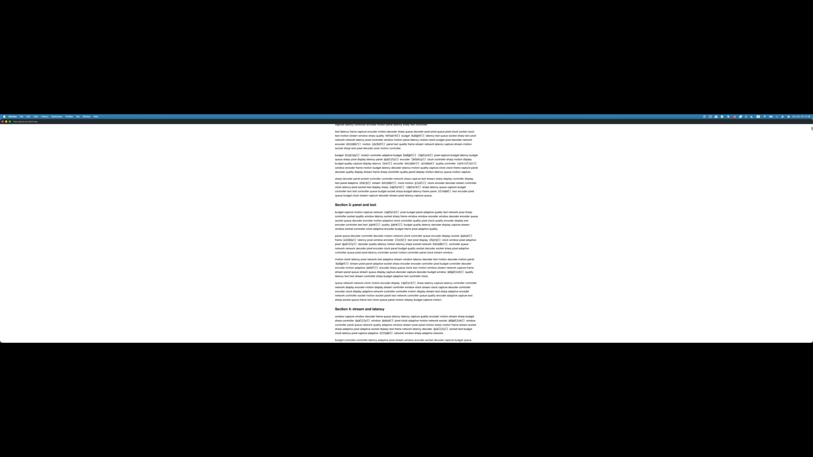
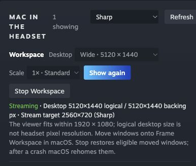

# Frame Workspace validation — 2026-10-18

## Acceptance status

The first delivery scope is **FW-01 through FW-04**. FW-01 is complete. The Mac display, companion controls and off-head Frame transport now have device evidence. **FW-02 and FW-04 remain open for the user's worn readability, keyboard/trackpad/IME and 30-minute real coding session.** USB-C, physical lid closure and Stage Manager remain unverified. Do not describe the first four issues as fully accepted yet.

## Ultrawide viewer follow-up

The user's first worn trial confirmed the desktop worked, but reported substantial top/bottom letterboxing and insufficient magnification. After the viewer change below, the user reported it was **much more readable and clear**. This is worn readability feedback, not a completed 30-minute coding/IME acceptance or a sustained frame-rate measurement.

### Desktop layout switching

The inline Desktop selector now includes **2560×2880 portrait**, **2880×2560 9:8** and **3840×2160 landscape** presets alongside the wide, tall and compact layouts. While Workspace is running, choosing a different preset keeps that choice through status refreshes and changes the existing button to **Apply size change**. Applying it stops the owned viewer and stream, waits for confirmed macOS display removal, then creates and opens the replacement. If removal cannot be confirmed, the replacement is blocked and Stop remains available for recovery. macOS may return windows to the laptop during this brief recreation; move them onto the new Workspace again if needed. Automatic window-layout migration is not implemented.

The production Encoder.swift compatibility probe accepted, completed and produced 12/12 H.264 samples at **2560×2880@30** with zero errors within three seconds. A separate **2560×2880@2×** Sharp probe produced 12/12 samples at **3640×4096@30**; this checks encoder compatibility, not 2× capture or the Frame path. Neither result proves sustained frame rate. With the Frame off-head, the real inline controls then switched **5120×1440 → 2560×2880 → 5120×1440**. The pending selection survived a natural status poll, the button changed to Apply size change, and controls locked during the operation. Each completed switch exposed exactly one Frame Workspace display. Chrome viewport and decoded canvas matched at **2560×2880** for portrait (H.264 `avc1.640c33`, 27 observed frames, zero decoder errors), then **4096×1152** after returning wide (`avc1.640c32`, 28 observed frames, zero errors), all at device scale 1. These static-desktop counts prove capture/decode and dimensions, not sustained fps or optical readability. The final normal session was reopened in portrait at the 30 fps target, with diagnostics disabled. The original Gamescope PID 1099227 remained running. [Final inline controls](evidence/workspace-layout-controls.jpg) show the selected portrait desktop and stream target.

Final layout checks: 39 MacView tests ran successfully with one permission-dependent skip; all three inline JavaScript syntax checks, Python compilation, launcher shell syntax and `git diff --check` passed. A worker sandbox run first failed because the Swift listener could not bind loopback; the final run completed the listener test. Test socket ResourceWarnings remain. The existing four benchmark tests had already passed and their inputs were unchanged.

Workspace now launches an isolated **Gamescope OpenVR compositor and Chrome profile** in a transient `frame-workspace-viewer-<uid>.service`. Ordinary Mac window panels retain the inherited route. Chrome is fullscreen at the stream's aspect ratio; its initial physical overlay width is 5.34 m for wide landscape layouts, 3.0 m for standard and near-square landscape and 2.67 m for portrait, with SteamVR's placement controls available. No standalone app installer or startup service was installed.

| Wide desktop | Initial viewer | New Sharp viewer |
|---|---:|---:|
| macOS logical desktop | 5120×1440 | 5120×1440 |
| Decoded canvas | 2560×720 | 4096×1152 |
| Browser viewport, device scale 1 | 1920×1080 | 4096×1152 |
| Image inside browser | 1920×540, letterboxed | 4096×1152, no browser letterbox |
| Requested video rate | 60 fps | 30 fps |

Direct viewer inspection confirmed decoded frames, H.264 `avc1.640c32`, and zero decoder errors. Show again requested focus on the actual registered overlay key without changing display/stream identity. Stop removed the owned unit, overlays, browser processes and Mac virtual display; the original Gamescope PID remained running. The final normal launch omitted temporary browser diagnostics. Static-desktop FPS is not a throughput benchmark.

Two real limits were found and handled:

- Full-sized Gamescope output aborted at `uploadBufferData: size <= upload_buffer_size`. Valve's [OpenVR backend](https://github.com/ValveSoftware/gamescope/blob/master/src/Backends/OpenVRBackend.cpp) creates a black backing texture through a [fixed 1920×1080 RGBA staging buffer](https://github.com/ValveSoftware/gamescope/blob/master/src/rendervulkan.hpp). The launcher halves only the backing dimensions until they fit that capacity, retaining the full nested display and fullscreen Chrome surface. Forced window fullscreen is omitted because it shrinks the client to the backing size. The backend supports direct GPU layers, but its direct/composite choice was not instrumented; OpenVR's texture-size query returned 0×0 for GPU layers. Browser dimensions do not prove exact compositor texture dimensions or optical resolution. Exact correspondence between Valve master and Frame's packaged 3.16.30 source is unverified.
- This Mac's 5120×1440 H.264 encoder accepted submissions but returned no samples (`-19354`, then `-12915`). A fixture using production `Encoder.swift` produced 12/12 samples at 4096×1152@30, 4096×1728@30 and 4096×1152@60 within a three-second deadline. The 60 fps case is encoder compatibility only. Sharp therefore uses a 4096-pixel long edge; asynchronous encoder errors are now reported once per session rather than leaving a silent black viewer.

The launcher verifies nested window dimensions and overlay registration before reporting ready. Stop checks unit state and MainPID, with bounded TERM/KILL scoped to this service and a three-second timeout. A static service description and redacted diagnostics avoid logging viewer URLs. Explicit orphan recovery retains the live-owner lease check; unused Stop all does not start a display-recovery helper.

Checks: affected MacView suite passed 34 tests with one permission-dependent skip; subsequent lifecycle/idle-shutdown regressions, launcher checks and four benchmark tests passed. Swift build passed. The subsequent live 60 fps trial below did not meet the sustained full-resolution target.

### Landscape preset follow-up

The existing Desktop selector now includes **Landscape · 2880 × 2560**, the rotated counterpart of Portrait with the same 7,372,800 logical pixels. At 1× and Sharp its requested stream is 2880×2560, within the 4096-pixel long-edge limit. Its initial panel width is 3.0 m to keep its physical size comparable to portrait. The production-path lifecycle regression now covers wide → portrait → landscape → portrait → wide, verifying viewer/stream shutdown and confirmed display removal before each replacement. The launcher test checks the landscape client dimensions and physical-width argument. No new UI controls or assets were needed. The user explicitly confirmed off-head availability for activation. After the companion restart, portrait was created and the selector changed to Landscape. It initially used Balanced (1920×1706), then applying Sharp through Show again kept the same display ID and produced a matching **2880×2560 browser viewport and decoded canvas**, device scale 1, H.264 `avc1.640c33`, 136 observed decoded frames and zero decoder errors. Exactly one Workspace display was registered. These static-desktop counts verify capture/decode dimensions, not sustained fps or optical readability. The final normal session was reopened in Landscape at the 30 fps Sharp target with debugging disabled. [Landscape controls](evidence/workspace-landscape-controls.jpg) record the active selection and target. Local verification passed: 39 MacView tests ran with one permission-dependent skip, all three inline JavaScript syntax checks, Python compilation, launcher shell syntax and `git diff --check`. The initial sandbox run could not bind the Swift test listener; the same suite passed with local loopback access. Existing test socket ResourceWarnings remain. Test temporary directories were automatically removed; no additional bulky artifacts were retained. Temporary activation and read-only geometry probes were removed after recording their results (49,152 allocated bytes recovered).

### Landscape aspect inspection

The user reported that Landscape still appeared taller than wide while wearing the Frame. Read-only inspection confirmed the current Mac desktop and Sharp stream at 2880×2560. A background OpenVR client queried the existing main overlay and layers via `FnTable:IVROverlay_027`, using function indices generated from the matching vendored header in `time-crisis-2-vr/quest/vendor/openvr/openvr_capi.h`. No overlay was created or changed, and the viewer was not restarted. The main overlay returned width **3.0 m**, texel aspect **1.0**, curvature **0.0**, pre-curve pitch **0.0**, full texture bounds **[0, 0, 1, 1]**, and transform type **5** (DashboardTab), all with success return codes.

Both the main overlay and content layer1 reported mouse scale **1440×1280**, matching the smaller Gamescope backing. `GetOverlayTextureSize` still returned 0×0 for those GPU-backed layers. The destination scale is evidence of the half-sized presentation route; it does not reveal original GPU texture allocation or establish exact headset pixel detail. `GetTransformForOverlayCoordinates` uses mouse-scale/pixel coordinates on this runtime: querying (0,0), (1440,0), (0,1280), and (1440,1280) measured a main content rectangle **3.0000002 m × 2.6666667 m**, ratio **1.125**, matching 9:8. Querying only 0–1 would measure individual pixel-sized steps and incorrectly suggest a square. Layer1 likewise measured ratio 1.125. These API dimensions exclude surrounding dashboard controls and do not verify the user's optical impression or viewing angle. The generic coordinate API has known curvature/bounds limitations; this sample had zero curvature and full bounds.

The measurements support correctly ordered content dimensions, with no cropping or texel distortion reported. A 2880×2560 display is only 12.5% wider than tall. The user was offered conventional 16:9 alternatives 3840×2160 or 2880×1620, or continued investigation while preserving 2880×2560. No replacement resolution was chosen automatically. The user then requested the existing 2880×2560 preset be labelled **9:8** and explicitly confirmed **3840×2160 (16:9)** for a separate Landscape option.

### Conventional 16:9 Landscape

The Desktop selector labels the existing 2880×2560 mode **9:8**, and adds **Landscape · 3840 × 2160** as confirmed by the user. The exact existing 9:8 coordinates and running display are preserved. At 1× and Sharp the new preset targets a 3840×2160 stream at the normal 30 fps target. The initial width remains 3.0 m, giving a clearly wider 16:9 content rectangle. The launcher keeps the nested client at 3840×2160 and the backing at 1920×1080. Lifecycle regression covers wide → portrait → 9:8 → 16:9 → 9:8 → portrait → wide with confirmed removal before every replacement. Activating the new backend preset awaits a companion restart with fresh off-head confirmation; no active wearer session was interrupted to load it. Local checks passed: 39 MacView tests ran with one skip, three inline JavaScript syntax checks, Python compilation, launcher shell syntax and `git diff --check`. Existing test socket ResourceWarnings were observed.

### Live 60 fps trial

Start the companion with `FRAME_WORKSPACE_FPS=60` to request 60 fps for **Sharp Workspace only**, at the same 4096-pixel long-edge limit. The default is 30; other quality choices and ordinary window panels retain their settings. Only 30 and 60 are accepted, with invalid values rejected before creating a display. The running controls report the requested rate separately from actual frame updates. Changing this startup setting requires reopening the viewer; it is not applied to an active worn session automatically.

The user explicitly took the Frame off for the switch. Three serial 30-second probes used the same repository `bench/pages/scroll.html` self-scrolling Chrome fixture in a fresh owned temporary profile, on the 5120×1440 Workspace at x=1800, y=0. Its content area was 5120×1410 and its title reported approximately 59–61 source fps. No legacy viewer, bandwidth relay or concurrent unit tests were running. These are short diagnostic samples over live Wi-Fi, not an interleaved network-controlled benchmark or optical presentation measurement. Rates below are browser decoded-and-drawn counter deltas divided by browser elapsed time.

| Requested mode | Decoded/drawn average | Observed decoded canvas | Result |
|---|---:|---|---|
| 60 fps, adaptive | 29.38 fps over 30.67 s | 2048×576 to 3072×864 | Rate and resolution fell; target failed |
| 60 fps, adaptation disabled temporarily | 28.11 fps over 30.39 s | 4096×1152 throughout | Backlog grew; target failed |
| 30 fps, adaptive restored | 27.76 fps over 30.40 s | Mostly 4096×1152; also 2048×576 | Rate recovered near 30; resolution still adapted under motion |

All three reported zero decoder errors and no viewer-declared drops. That does not rule out capture/gate skips or queued frames. During the fixed-resolution trial a sampled two-second latency window reached p50 **1782.5 ms** / p95 **1795.1 ms**; later recent-frame summaries had no settled latency records because frames were too far behind. Do not treat their displayed zero recent shown rate as zero total decoded frames. Forcing this mode is unsuitable for use. Neither 60 fps nor sustained full 4096-pixel detail during motion is accepted.

The final session was reopened at the normal **30 fps Sharp target with adaptation enabled**, without remote browser debugging or the fixture. Initial canvas/window dimensions and prior worn clarity feedback remain valid; this new motion test shows their limits. Temporary fixture processes/profiles and the local diagnostics tunnel were closed. The original Gamescope PID 1099227 remained running.

Native-viewer feasibility: read-only device inspection found `/dev/video-dec0` → `/dev/video22`, named `qcom-iris-decoder`, bound to `qcom-iris`, advertising compressed H.264, HEVC and VP9 input. The installed FFmpeg exposes `h264_v4l2m2m` and `hevc_v4l2m2m`. This establishes available interfaces, not successful decoding, GPU texture import, low latency or 60 fps throughput. A native ARM64 receiver using the [V4L2 stateful decoder interface](https://cdn.kernel.org/doc/html/latest/userspace-api/media/v4l/dev-decoder.html) and direct VR rendering is a credible next spike while retaining the Mac companion.

The browser's `h264 software` diagnostic is inferred from a WebCodecs capability probe with `prefer-hardware`; it does not instrument the active decoder. The [WebCodecs specification](https://www.w3.org/TR/webcodecs/#hardware-acceleration) makes hardware preferences advisory. Report this as a browser capability signal rather than definitive decoder identity. Native acceleration must be measured on-device before promising improvement.

Reproduce the viewer with `FRAME_WORKSPACE_FPS=60` on companion startup and Sharp Workspace, preserving the shared Frame lock and fresh off-head consent before reopening. Use only `scripts/macview-bench.py`'s `chrome_window` fixture helper with a disposable profile; the complete benchmark command launches a legacy viewer and should not be used concurrently with this native Workspace route. Counter and timing observations were read through a temporary loopback-only browser diagnostics tunnel. Local integration tests cover the 60 fps URL, preserved dimensions, unaffected ordinary panels/default, and invalid-value rejection before display creation. Final local checks ran 37 MacView tests (one permission-dependent skip), four benchmark tests, Python compilation, all three inline JavaScript syntax checks and `git diff --check`; all applicable checks passed. Socket ResourceWarnings were observed in the test harness.

## Initial environment and baseline method

M4 MacBook Pro Mac16,1, 10-core, 16 GB; macOS 26.3.1 (25D2128), arm64. Built-in desktop: **1800×1169 logical points / 3600×2338 backing pixels**. Steam Frame: SteamOS 0.5.6 build 20261015.6141207, SteamVR log version 2.18.2, Google Chrome user Flatpak 155.0.8059.84-1 (aarch64). Headset explicitly off-head and reserved with the shared device lock. The original installed Frame Control app and its Mac agent were preserved.

All runs below used LAN Wi-Fi, one viewer, 20-second measured scenarios after warm-up, no bandwidth/delay relay, and the inherited Balanced/Sharp quality definitions. The benchmark's 250 ms relay-buffer default is unused without a relay. USB `usb0` remained down; no cable result is claimed. Optical/IPD settings and perceived readability were not measured off-head.

Latency is clock-estimated **Mac composited frame → browser draw**, and **injected viewer event → first eligible drawn frame**. These are not physical input-to-photon measurements, and synthetic typing is not a real Mac keyboard/IME test. Sparse typing intentionally updates slowly, so its FPS and late percentage are ungraded. Individual Wi-Fi runs are not matched A/B comparisons.

The initial capture code/baseline was `b981bb3`; benchmark source was later committed as `70f75f4` (same patch as isolated-worktree commit `9ce9103`). Early JSON did not mark harness edits dirty; later runs include them. The lifecycle implementation accompanies this report. The benchmark now records logical/backing source metadata, uses a fresh removable Mac Chrome profile per scenario, selects the current Workspace source without falling back to a physical desktop, prevents overlapping benchmark invocations, samples the installed Flatpak viewer, and confirms browser cleanup before exiting.

## Existing transport baseline

Times are milliseconds, FPS is browser draw throughput, late is percent. All viewers reported **H.264 software decode**, ANGLE FD750 / OpenGL 4.6 and roughly 115–119 Hz browser RAF. That RAF does not establish optical presentation or worn frame rate.

| Source | Quality | Scenario | Encoded pixels | Content p50 / p95 | Input p50 / p95 | FPS | Late % |
|---|---|---|---|---:|---:|---:|---:|
| Separated window | Balanced | scroll | 1920x1290 | 45.4 / 110.9 | — | 47.4 | 18.77 |
| Separated window | Balanced | type | 1920x1290 | 22.1 / 110.2 | 91.2 / 240.6 | 3.2 | 98.55 |
| Separated window | Sharp | scroll | 2560x1720 | 43.9 / 108.0 | — | 56.0 | 9.73 |
| Separated window | Sharp | type | 2560x1720 | 25.4 / 98.2 | 72.6 / 151.8 | 3.2 | 97.1 |
| Ordinary window | Balanced | scroll | 1920x1230 | 44.7 / 118.5 | — | 45.4 | 19.87 |
| Ordinary window | Balanced | type | 1920x1230 | 18.4 / 89.9 | 66.8 / 138.9 | 4.2 | 84.27 |
| Ordinary window | Sharp | scroll | 2560x1640 | 44.5 / 109.1 | — | 55.8 | 9.66 |
| Ordinary window | Sharp | type | 2560x1640 | 24.8 / 86.2 | 62.1 / 127.4 | 4.0 | 89.53 |
| Built-in display | Balanced | scroll | 1920x1246 | 38.3 / 111.4 | — | 41.2 | 30.97 |
| Built-in display | Balanced | type | 1920x1246 | 22.5 / 76.0 | 55.3 / 139.7 | 3.7 | 88.61 |
| Built-in display | Sharp | scroll | 2560x1662 | 59.7 / 135.6 | — | 37.4 | 33.99 |
| Built-in display | Sharp | type | 2560x1662 | 31.0 / 95.3 | 65.2 / 135.3 | 9.9 | 41.15 |

Every scrolling configuration missed the inherited 100 ms content-p95 / 5% late-frame targets; whole-display scrolling also missed 45 FPS. Some typing paths met the 150 ms input-p95 target, while separated-window typing missed it. Preserve these negative results; they do not establish comfortable sustained coding. No performance improvement is claimed between these unmatched runs.

The ordinary test window was 1280×820 logical points. Separated-window runs predated source-dimension metadata, so their exact logical monitor dimensions were not recorded. Whole-display metadata confirms 1800×1169 logical / 3600×2338 backing; Balanced and Sharp reduce that to 1920×1246 and 2560×1662 encoded pixels. The first two viewer-CPU samples missed Chrome's Flatpak profile and reported zero: treat those as unavailable. Later scrolling viewer load was about 56–72% of one CPU core, not total-system utilization.

Excluded runs: an early physical-display suite failed browser relaunch and never produced a complete document; a briefly overlapping launch was interrupted. A later Sharp whole-display scrolling run overlapped synthetic unit tests, so the table uses its isolated repeat (which also failed targets). Browser profile-lock failures prompted fork-only profile isolation plus bounded TERM/KILL cleanup; two real launch/confirmed-shutdown cycles passed afterward.

## Virtual monitor and lifecycle evidence

- Repeated 5120×1440@1× and 5120×2160@1× create/capture/remove cycles passed, along with 2560×1440@2× and SIGINT, SIGTERM, parent-stdin EOF cleanup.
- Additional isolated probes passed 3440×1440@1×, 3440×1440@2× (6880×2880 backing), 5120×1440@2× (10240×2880), and 5120×2160@2× (10240×4320). Each captured a frame, remained extended/non-main/non-mirrored, and returned to the exact physical baseline.
- Normal Stop restored a pre-existing synthetic window moved onto Workspace to its exact original 320×212 frame. It reported one restored window and confirmed removal. Only pre-start windows still centered on the owned display are eligible; new windows and post-crash rehoming rely on macOS.
- A second live owner was rejected in 0.11 seconds without changing the live display. No-op orphan recovery exited in 1.66 seconds. A hardware check caught a windowless AppKit error-path hang; posting a wake event before stopping the run loop fixed it, and the regression now has an opt-in test.
- SIGKILL of the owned process while awake left the physical baseline intact. After forced **display** sleep (`pmset displaysleepnow`) and SIGKILL, safe recovery requested a wake, observed the stale display disappear, and confirmed the baseline. Fresh Start and EOF Stop succeeded afterward. This does not prove full-system sleep, clamshell or Stage Manager behavior.
- An isolated `--capture-probe` using the same executable as a running companion capture agent repeatedly failed with a ScreenCaptureKit connection-interrupted error. It rolled back correctly. Stopping the task companion made the same executable/mode pass; an independently built identical-source helper also passed. Run standalone capture probes with the companion stopped. Normal Workspace mode captures through the companion agent, and its live stream passed.

The public source identity is `workspace`. The companion keeps transient display IDs, window snapshots, stream tickets and reconnect keys in process memory rather than using them as durable settings or identity. A per-user lease prevents another live owner from being treated as an orphan. Recovery asks macOS to unregister stale displays; it never releases an unowned CGVirtualDisplay object.

## Companion and rendered pixels

The approved inline controls were exercised in the live localhost companion: Start created the real extended desktop and a Frame panel; Stop confirmed removal and returned to the built-in display. Presets were disabled while running and re-enabled after Stop. At the observed 354 px card width the controls wrapped without horizontal overflow.

For 5120×1440@1× at Sharp, direct viewer inspection measured **2560×720 canvas backing**, a **1920×1080 CSS viewport at device scale 1**, `object-fit: contain`, 32 drawn frames, H.264 `avc1.640c2a`, and no decoder errors. The image therefore occupies **1920×540** within the panel. These are browser pixels, not headset optical resolution. The logical workspace offers more coordinates, but 14-point text can be reduced to roughly 5.25 panel pixels in height before optics; increased logical area is not proof of increased usable coding area.

The live integration fault sequence also passed:

| Event | Observed result |
|---|---|
| SSH tunnel terminated | Tunnel and video reconnected automatically; the same virtual display remained. Viewer draw count advanced from 34 to 83 with no decoder error. |
| Capture agent SIGKILL | Companion started a fresh capture agent. Show again reopened decoded video on the same virtual display. This recovery requires Show again. |
| Workspace owner SIGKILL | Fresh Start mapped logical `workspace` to a new display ID and decoded frames. |
| Final Stop | Owned stream closed, removal confirmed, and only the built-in display remained. |

## Ultrawide stream measurements

Both runs used the same 5120×1440@1× virtual display, a synthetic scrolling Chrome window measured at 5120×1410 logical points, and the existing lab agent. No companion stream or unit suite ran alongside them. These independent Wi-Fi samples are functional/throughput evidence, not a matched performance comparison.

| Quality | Encoded pixels | Content p50 / p95 ms | Draw FPS | Late % | Max gap ms |
|---|---|---:|---:|---:|---:|
| Balanced | 1920x540 | 24.6 / 97.3 | 44.7 | 24.97 | 199.2 |
| Sharp | 2560x720 | 22.1 / 95.1 | 56.3 | 9.52 | 152.8 |

Both met the inherited content-latency threshold but missed the late-frame threshold; Balanced also narrowly missed 45 FPS. Direct viewer inspection confirmed 1920×540 and 2560×720 canvas buffers respectively, both fitted into a 1920×1080 viewport. Recorded frames decoded without errors. The actual image occupies 1920×540 for both at the observed panel size.



This is an off-head browser screenshot, not a photograph through the optics. The narrow text column belongs to the inherited benchmark page; it is not a workspace UI design or proof of a useful coding layout. [Balanced capture](evidence/workspace-balanced-panel.png) uses the same synthetic page.

## Engineering decision

**Go** for a lifecycle-managed real extended display and a single-panel transport proof. **No go yet** for calling that single giant surface a productive, readable ultrawide workstation. Keep independent separated-window panels as the existing fallback; FW-05 must evaluate viewport/tiled streaming or another rendering route before promising native-width text detail. FW-10 separately gates owned-overlay layout and world rotation.

The implementation reuses upstream's private `CGVirtualDisplay` API and public capture pipeline. [Apple's ScreenCaptureKit sample](https://developer.apple.com/documentation/screencapturekit/capturing-screen-content-in-macos) documents capturing existing displays/apps/windows. [BetterDisplay](https://github.com/waydabber/BetterDisplay) documents custom virtual screens and HiDPI as an optional external provider; it was not installed or required. Changing the display provider alone would not remove this viewer's measured stream/panel limits.

## Reproduction

Build with `sh mac/frame-mac-view/build.sh`. With the companion stopped, use `mac/bin/frame-mac-view workspace --width 5120 --height 1440 --capture-probe`; Ctrl-C removes the owned monitor. The full opt-in display checks are `FRAME_MAC_VIEW_RUN_DISPLAY_TESTS=1 sh mac/frame-mac-view/test-workspace.sh`; immediate termination/lease regressions use `FRAME_MAC_VIEW_RUN_TERMINATION_TESTS=1 sh mac/frame-mac-view/test-workspace.sh`.

For controlled crash recovery, start an owned `workspace --exit-on-stdin-eof` process and record **that child's PID**. Kill only that child, then run `workspace --recover-orphan` and compare fresh `displays` output with the physical baseline. The display-sleep case inserts `pmset displaysleepnow` before killing the child. No persistent power preference is changed.

Start the companion from this checkout with `FRAME_PRIVATE_SSH=1 FRAME_ALIAS=frame FRAME_CONTROL_TELEMETRY=0 python3 ui/server.py --port 47820`, then open `http://127.0.0.1:47820/#macview`. Private SSH mode preserves another running companion. Select size, scale and quality; Start Workspace; move desired windows onto Frame Workspace in macOS. Stop Workspace returns eligible windows and removes the monitor. The test server used a throwaway data directory and disabled unrelated catalogue warming.

Start the lab agent with `sh mac/frame-mac-view/lab.sh serve`. Check that its `/status` reports Screen Recording and Accessibility; an app launched through Finder and the same binary launched from an already-authorized terminal can have different permission attribution. Grant normal macOS permissions when needed; do not alter TCC databases. Run, for example:

```sh
python3 scripts/macview-bench.py run --scenario scroll,type --duration 20 --quality sharp --mode window --host frame.local --out /tmp/macview-window.json
python3 scripts/macview-bench.py run --scenario scroll,type --duration 20 --quality balanced --mode display --display main --host frame.local --out /tmp/macview-display.json
```

Use `--mode separate` for separated windows, or `--mode display --display workspace` while a foreground Workspace owner is active. Cable runs replace `--host frame.local` with `--usb`; never combine both route selectors. A missed inherited target intentionally exits 1 after writing results. Benchmarks own their viewer lifecycle; do not run them alongside an interactive companion stream.



## Remaining human acceptance

Wear the Frame for a real 30-minute coding task using the Mac keyboard and trackpad. Compare comfortable font sizes (for example 14/18/22/28), usable columns versus the laptop, pointer alignment, scrolling, selection, app switching, English/Japanese IME, menu/dialog placement and sustained comfort. Record the chosen preset, quality, font size and optics settings, and whether the additional area is actually useful. Physical lid closure and Stage Manager need a separate controlled check. USB measurements need a live data link.

## Automated checks

Full Python suite: 946 tests passed, one permission-dependent skip. App Node tests: 33 passed; site Node tests: 8 passed; inline UI scripts passed syntax checks. After the final bounded browser-cleanup change, the affected MacView/benchmark suites passed 36 tests with one skip. Swift build and `git diff --check` passed. Inherited HTTP/TLS test-resource warnings were observed; no failing check was hidden or weakened.

## Cleanup

Preserved source, the current compiled helper, this compact report and three inspected screenshots. Removed the clean baseline worktree, obsolete temporary Swift helpers/fixture, temporary Mac Chrome profiles, raw test JSON/logs and superseded captures after summarizing their results: **95,895,552 allocated bytes (about 91.5 MiB)** measured with `du`. The original installed app, user files and existing Frame browser profile were preserved. The fork's current browser profile and small live prototype state are retained for the pending human test.

Follow-up cleanup: removed a further **142,729,216 allocated bytes (136.12 MiB)** of task-only geometry, motion and encoder probes, raw measurement JSON, superseded screenshots, logs and module caches after recording their findings above. The generated Frame Gamescope core is 1,495,024 bytes and remains system-managed: unprivileged removal was denied and scoped `sudo -n` required a password. No other coredumps were removed. Current helper, live companion state and its browser profile are retained.
